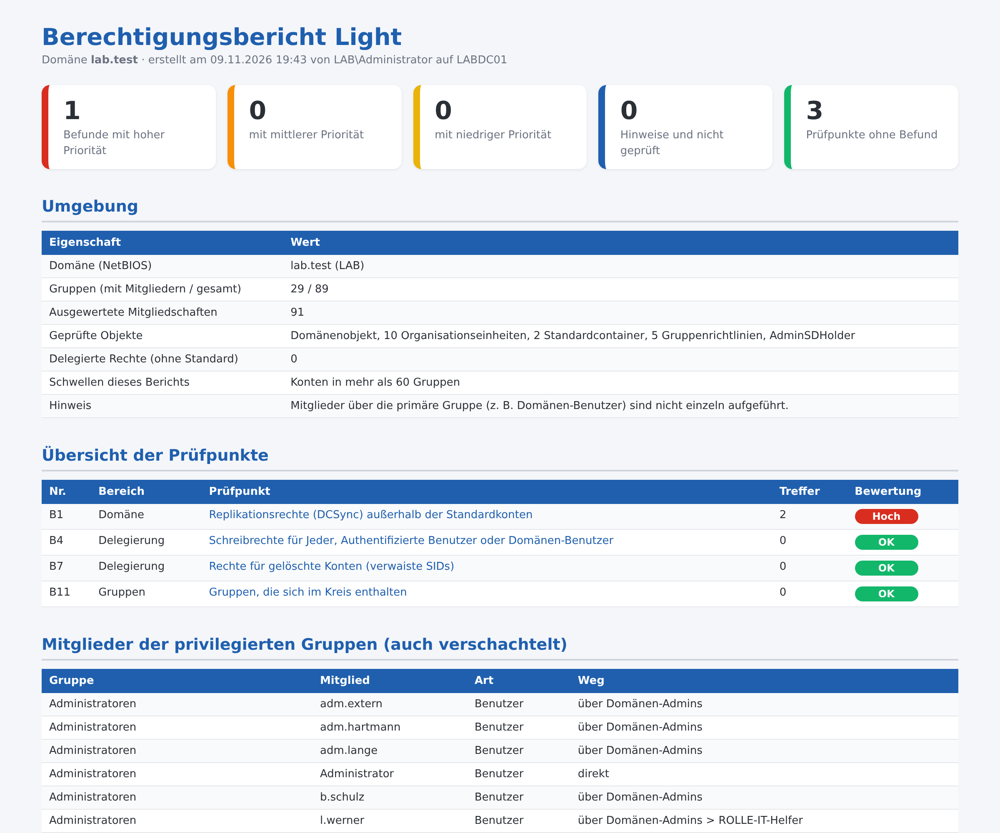

# Berechtigungsbericht Light – Rechte im Active Directory prüfen

Kostenloses PowerShell-Skript: prüft Berechtigungen und Delegierungen im Active Directory in **4 Punkten** und erzeugt einen übersichtlichen **HTML-Bericht auf Deutsch oder Englisch** (`-Language de|en`, Standard je nach Windows-Sprache). Es arbeitet **ausschließlich lesend**: Es ändert nichts, legt keine Objekte an und sendet keine Daten an Dritte oder ins Internet.



Der gezeigte Bericht stammt aus einer Testdomäne. Das vollständige Beispiel liegt als [Beispielbericht.html](Beispielbericht.html) bei.

## Was geprüft wird

| Nr. | Bereich | Prüfpunkt |
|---|---|---|
| B1 | Domäne | Replikationsrechte (DCSync) außerhalb der Standardkonten |
| B4 | Delegierung | Schreibrechte für Jeder, Authentifizierte Benutzer oder Domänen-Benutzer |
| B7 | Delegierung | Rechte für gelöschte Konten (verwaiste SIDs) |
| B11 | Gruppen | Gruppen, die sich im Kreis enthalten |

Jeder Befund kommt mit Erklärung und Empfehlung.

## Start

```powershell
powershell -ExecutionPolicy Bypass -File .\Berechtigungsbericht-Light.ps1
```

Alle Optionen zeigt `Get-Help .\Berechtigungsbericht-Light.ps1 -Detailed`. Voraussetzungen und Rechte stehen im Kopf des Skripts. Getestet mit Windows Server 2025 in Testdomänen (deutsches Windows).

## Vollversion

Die Light-Version enthält 4 von 14 Prüfpunkten (29 %). Die **Vollversion** prüft zusätzlich unter anderem:

- Weitreichende Rechte am Domänenobjekt oder auf alle Objekte darunter
- Zusätzliche Rechte auf AdminSDHolder
- Delegierte Rechte auf Domäne, Organisationseinheiten und Container
- Rechte direkt an einzelne Benutzerkonten vergeben
- Besitzer ist keine Administratorgruppe
- Organisationseinheiten mit abgeschalteter Vererbung
- Gruppenrichtlinien, die Nicht-Administratoren bearbeiten dürfen
- Konten in mehr als N Gruppen
- Berechtigungen nicht lesbar
- Rechte der Exchange-Gruppen am Domänenobjekt und an AdminSDHolder

➜ **[Vollversion auf Gumroad](https://mueller86.gumroad.com/l/xyjmdr)** · **[Vollversion auf Etsy](https://www.etsy.com/listing/4593113568)** · **[alle Prüfskripte im Shop](https://www.etsy.com/shop/ITAdminToolsbyMM)**

## Weitere kostenlose Prüfskripte

- [AD-Schnellcheck](https://github.com/jackyno7/ad-schnellcheck) (8 Prüfpunkte zur Domäne)
- [Rechner Inventar Light](https://github.com/jackyno7/rechner-inventar-light)
- [Anmelde Sperrbericht Light](https://github.com/jackyno7/anmelde-sperrbericht-light)
- [Dateiserver Bericht Light](https://github.com/jackyno7/dateiserver-bericht-light)
- [GPO Bericht Light](https://github.com/jackyno7/gpo-bericht-light)
- [Kerberos Altlasten Check Light](https://github.com/jackyno7/kerberos-altlasten-check-light)
- [DNS DHCP Bericht Light](https://github.com/jackyno7/dns-dhcp-bericht-light)
- [DC Gesundheitsbericht Light](https://github.com/jackyno7/dc-gesundheitsbericht-light)

<!-- querverweis:anfang -->
## Alle Skripte und Vorlagen

Übersicht aller Prüfskripte und Vorlagen: **[github.com/jackyno7](https://github.com/jackyno7)**

Vollversionen:

- Active Directory Prüfbericht: [Etsy](https://www.etsy.com/listing/4588853943) · [Gumroad](https://mueller86.gumroad.com/l/fcneoc)
- Domänencontroller-Gesundheitsbericht: [Etsy](https://www.etsy.com/listing/4593087246) · [Gumroad](https://mueller86.gumroad.com/l/bseljr)
- DNS- und DHCP-Bericht: [Etsy](https://www.etsy.com/listing/4593096270) · [Gumroad](https://mueller86.gumroad.com/l/sthgh)
- Kerberos- und Altlasten-Check: [Etsy](https://www.etsy.com/listing/4593092377) · [Gumroad](https://mueller86.gumroad.com/l/zptvct)
- Berechtigungsbericht Active Directory: [Etsy](https://www.etsy.com/listing/4593113568) · [Gumroad](https://mueller86.gumroad.com/l/xyjmdr)
- GPO-Bericht: [Etsy](https://www.etsy.com/listing/4593129111) · [Gumroad](https://mueller86.gumroad.com/l/wdosl)
- Anmelde- und Sperrbericht: [Etsy](https://www.etsy.com/listing/4593157082) · [Gumroad](https://mueller86.gumroad.com/l/ztktaaq)
- Rechner-Inventar aus Active Directory: [Etsy](https://www.etsy.com/listing/4593088535) · [Gumroad](https://mueller86.gumroad.com/l/zzycdd)
- Dateiserver-Bericht: [Etsy](https://www.etsy.com/listing/4612420692) · [Gumroad](https://mueller86.gumroad.com/l/wbbwj)
- Dateiserver-Rechte-Bericht: [Etsy](https://www.etsy.com/listing/4616706194) · [Gumroad](https://mueller86.gumroad.com/l/ijrkb)
- Windows-Rechnerbericht: [Etsy](https://www.etsy.com/listing/4616020701) · [Gumroad](https://mueller86.gumroad.com/l/wmhfk)
- Exchange-Postfachbericht: [Etsy](https://www.etsy.com/listing/4614916333) · [Gumroad](https://mueller86.gumroad.com/l/gkdllj)
- Exchange-Kalenderrechte-Bericht: [Etsy](https://www.etsy.com/listing/4614799790) · [Gumroad](https://mueller86.gumroad.com/l/iabfb)
- Exchange-Nachrichtenverfolgung: [Etsy](https://www.etsy.com/listing/4614785975) · [Gumroad](https://mueller86.gumroad.com/l/msria)
- Active Directory Prüfskript-Paket: [Etsy](https://www.etsy.com/listing/4611942401) · [Gumroad](https://mueller86.gumroad.com/l/awzjtc)

Vorlagen und Checklisten (Notfallplan, Backup, Passwortrichtlinie, Onboarding, Homeoffice, Netzwerk-Dokumentation): [Etsy](https://www.etsy.com/shop/ITAdminToolsbyMM) · [Gumroad](https://mueller86.gumroad.com)
<!-- querverweis:ende -->

## Hinweise

- Der Bericht enthält Konto-, Rechner- oder Servernamen – bitte vertraulich behandeln.
- Der Bericht zeigt Auffälligkeiten anhand fester Regeln. Er ersetzt keine Sicherheitsprüfung und erhebt keinen Anspruch auf Vollständigkeit.
- Nutzung auf eigene Verantwortung, siehe [LICENSE](LICENSE).
- Bei der Ausarbeitung wurden KI-Werkzeuge unterstützend eingesetzt; Inhalte und Skript wurden fachlich geprüft und im Testlab getestet.

---

### English

Free, read-only PowerShell script that checks permissions and delegations in Active Directory (4 checks, HTML report in German or English (`-Language de|en`) with findings and recommendations). No changes are made and no data is sent to third parties or the internet; the report stays local. Run: `powershell -ExecutionPolicy Bypass -File .\Berechtigungsbericht-Light.ps1`. The full version with 14 checks: https://mueller86.gumroad.com/l/xyjmdr

<!-- querverweis-en:anfang -->
#### All scripts and templates

Overview of all check scripts and templates: **[github.com/jackyno7](https://github.com/jackyno7)**

Full versions:

- Active Directory Audit Report: [Etsy](https://www.etsy.com/listing/4588853943) · [Gumroad](https://mueller86.gumroad.com/l/fcneoc)
- Domain Controller Health Report: [Etsy](https://www.etsy.com/listing/4593087246) · [Gumroad](https://mueller86.gumroad.com/l/bseljr)
- DNS and DHCP Report: [Etsy](https://www.etsy.com/listing/4593096270) · [Gumroad](https://mueller86.gumroad.com/l/sthgh)
- Kerberos and Legacy Check: [Etsy](https://www.etsy.com/listing/4593092377) · [Gumroad](https://mueller86.gumroad.com/l/zptvct)
- Active Directory Permissions Report: [Etsy](https://www.etsy.com/listing/4593113568) · [Gumroad](https://mueller86.gumroad.com/l/xyjmdr)
- GPO Report: [Etsy](https://www.etsy.com/listing/4593129111) · [Gumroad](https://mueller86.gumroad.com/l/wdosl)
- Logon and Lockout Report: [Etsy](https://www.etsy.com/listing/4593157082) · [Gumroad](https://mueller86.gumroad.com/l/ztktaaq)
- Computer Inventory from Active Directory: [Etsy](https://www.etsy.com/listing/4593088535) · [Gumroad](https://mueller86.gumroad.com/l/zzycdd)
- File Server Report: [Etsy](https://www.etsy.com/listing/4612420692) · [Gumroad](https://mueller86.gumroad.com/l/wbbwj)
- File Server Permissions Report: [Etsy](https://www.etsy.com/listing/4616706194) · [Gumroad](https://mueller86.gumroad.com/l/ijrkb)
- Windows Computer Report: [Etsy](https://www.etsy.com/listing/4616020701) · [Gumroad](https://mueller86.gumroad.com/l/wmhfk)
- Exchange Mailbox Report: [Etsy](https://www.etsy.com/listing/4614916333) · [Gumroad](https://mueller86.gumroad.com/l/gkdllj)
- Exchange Calendar Permissions Report: [Etsy](https://www.etsy.com/listing/4614799790) · [Gumroad](https://mueller86.gumroad.com/l/iabfb)
- Exchange Message Tracking: [Etsy](https://www.etsy.com/listing/4614785975) · [Gumroad](https://mueller86.gumroad.com/l/msria)
- Active Directory Check Script Bundle: [Etsy](https://www.etsy.com/listing/4611942401) · [Gumroad](https://mueller86.gumroad.com/l/awzjtc)

Templates and checklists (emergency plan, backup, password policy, onboarding, home office, network documentation): [Etsy](https://www.etsy.com/shop/ITAdminToolsbyMM) · [Gumroad](https://mueller86.gumroad.com)
<!-- querverweis-en:ende -->
