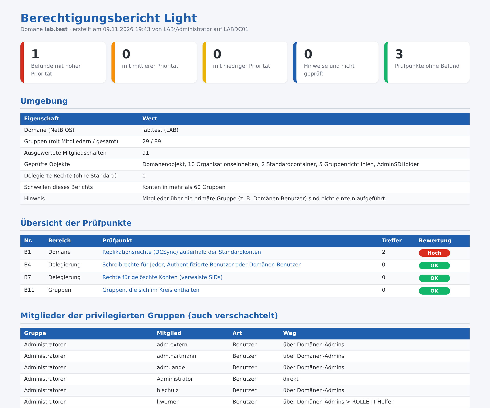

# Berechtigungsbericht Light – Rechte im Active Directory prüfen

Kostenloses PowerShell-Skript: prüft Berechtigungen und Delegierungen im Active Directory in **4 Punkten** und erzeugt einen übersichtlichen **HTML-Bericht auf Deutsch**. Es arbeitet **ausschließlich lesend**: Es ändert nichts, legt nichts an und überträgt keine Daten.



Der gezeigte Bericht stammt aus einer Testdomäne. Das vollständige Beispiel liegt als [Beispielbericht.html](Beispielbericht.html) bei.

## Was geprüft wird

| Nr. | Bereich | Prüfpunkt |
|---|---|---|
| B1 | Domäne | Replikationsrechte (DCSync) außerhalb der Standardkonten |
| B4 | Delegierung | Schreibrechte für Jeder, Authentifizierte Benutzer oder Domänen-Benutzer |
| B7 | Delegierung | Rechte für gelöschte Konten (verwaiste SIDs) |
| B11 | Gruppen | Gruppen, die sich im Kreis enthalten |

Jeder Befund kommt mit Erklärung und Empfehlung.

## Start

```powershell
powershell -ExecutionPolicy Bypass -File .\Berechtigungsbericht-Light.ps1
```

Alle Optionen zeigt `Get-Help .\Berechtigungsbericht-Light.ps1 -Detailed`. Voraussetzungen und Rechte stehen im Kopf des Skripts. Getestet mit Windows Server 2019, 2022 und 2025 in Testdomänen (deutsches Windows).

## Vollversion

Die Light-Version enthält 4 von 14 Prüfpunkten (29 %). Die **Vollversion** prüft zusätzlich unter anderem:

- Weitreichende Rechte am Domänenobjekt oder auf alle Objekte darunter
- Zusätzliche Rechte auf AdminSDHolder
- Delegierte Rechte auf Domäne, Organisationseinheiten und Container
- Rechte direkt an einzelne Benutzerkonten vergeben
- Besitzer ist keine Administratorgruppe
- Organisationseinheiten mit abgeschalteter Vererbung
- Gruppenrichtlinien, die Nicht-Administratoren bearbeiten dürfen
- Konten in mehr als N Gruppen
- Berechtigungen nicht lesbar
- Rechte der Exchange-Gruppen am Domänenobjekt und an AdminSDHolder

➜ **[Vollversion auf Gumroad](https://mueller86.gumroad.com/l/xyjmdr)** · **[Vollversion auf Etsy](https://www.etsy.com/listing/4593113568)** · **[alle Prüfskripte im Shop](https://www.etsy.com/shop/ITAdminToolsbyMM)**

## Weitere kostenlose Prüfskripte

- [AD-Schnellcheck](https://github.com/jackyno7/ad-schnellcheck) (8 Prüfpunkte zur Domäne)
- [Rechner Inventar Light](https://github.com/jackyno7/rechner-inventar-light)
- [Anmelde Sperrbericht Light](https://github.com/jackyno7/anmelde-sperrbericht-light)
- [Dateiserver Bericht Light](https://github.com/jackyno7/dateiserver-bericht-light)
- [GPO Bericht Light](https://github.com/jackyno7/gpo-bericht-light)
- [Kerberos Altlasten Check Light](https://github.com/jackyno7/kerberos-altlasten-check-light)
- [DNS DHCP Bericht Light](https://github.com/jackyno7/dns-dhcp-bericht-light)
- [DC Gesundheitsbericht Light](https://github.com/jackyno7/dc-gesundheitsbericht-light)

## Hinweise

- Der Bericht enthält Konto-, Rechner- oder Servernamen – bitte vertraulich behandeln.
- Der Bericht zeigt Auffälligkeiten anhand fester Regeln. Er ersetzt keine Sicherheitsprüfung und erhebt keinen Anspruch auf Vollständigkeit.
- Nutzung auf eigene Verantwortung, siehe [LICENSE](LICENSE).
- Bei der Ausarbeitung wurden KI-Werkzeuge unterstützend eingesetzt; Inhalte und Skript wurden fachlich geprüft und im Testlab getestet.

---

### English

Free, read-only PowerShell script that checks permissions and delegations in Active Directory (4 checks, German HTML report with findings and recommendations). No changes are made and no data leaves the machine. Run: `powershell -ExecutionPolicy Bypass -File .\Berechtigungsbericht-Light.ps1`. The full version with 14 checks: https://mueller86.gumroad.com/l/xyjmdr
